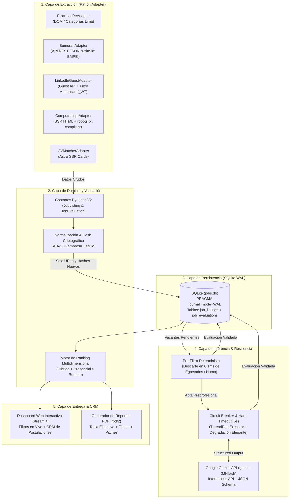
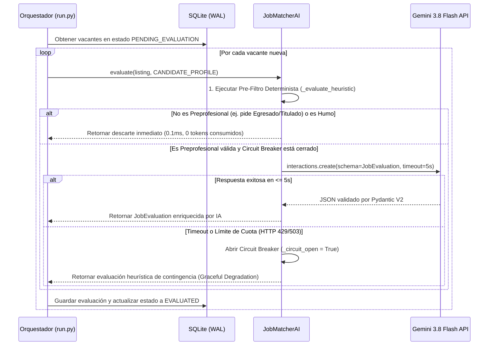

# 🎯 Job Hunter & ATS Tailor Agent — Radar Inteligente de Prácticas Preprofesionales


> **Autor:** Joseph Pajuelo Cárdenas — *Ingeniería de Sistemas e Informática (UTP)*  
> **Enfoque:** Ingeniería de Inteligencia Artificial · Análisis de Datos · Arquitectura de Software Robusto

---

## 📌 1. Problema y Propuesta de Valor

Buscar prácticas preprofesionales de tecnología y datos en Lima implica revisar manualmente múltiples portales (**Bumeran, LinkedIn, CompuTrabajo, Practicas.pe, CVMatcher**) donde:
1. **Existe alta duplicidad:** Una misma convocatoria se republica en 3 o 4 plataformas distintas.
2. **Abundan las "ofertas trampa":** Vacantes tituladas *"Practicante"* que en los requisitos exigen ser egresado/bachiller (*Practicante Profesional*) o contar con 2+ años de experiencia.
3. **Pérdida de trazabilidad:** Es difícil llevar el control de a qué ofertas ya se postuló, en qué fecha y con qué *pitch* de presentación.

**Job Hunter & ATS Tailor Agent** resuelve este problema mediante un pipeline automatizado de ingeniería de datos e IA que:
* **Extrae en tiempo real** las vacantes más recientes de **5 portales de empleo** aplicando técnicas específicas por plataforma (consumo de APIs REST JSON internas, endpoints públicos de invitados y parseo SSR).
* **Deduplica criptográficamente** cada oferta mediante un hash `SHA-256(empresa + título_normalizado)` y memoria de URLs (`known_urls`) para no reprocesar anuncios ya vistos.
* **Filtra y evalúa la compatibilidad (0 a 100)** combinando un pre-filtro determinista de baja latencia con **Google Gemini (`gemini-3.8-flash`)** bajo esquemas estrictos de salida estructurada (**JSON Schema + Pydantic V2**) y protección con **Circuit Breaker**.
* **Genera un Elevator Pitch personalizado** para cada vacante, alineando la experiencia real del candidato con los requisitos técnicos del puesto.
* **Provee un Dashboard Web interactivo + CRM de Postulaciones + Exportador PDF** para gestionar estados (`📋 Por postular`, `⭐ Favorita`, `🚀 Postulado`, `🎤 En entrevista`, `❌ Descartada`) y notas personales.

---

## 🏛️ 2. Arquitectura del Sistema

El sistema está diseñado bajo una **Arquitectura Modular por Capas y el Patrón Adapter (Puertos y Adaptadores ligero)**, garantizando el desacoplamiento total entre la extracción web, las reglas de dominio, la persistencia transaccional, el motor de IA y la interfaz de usuario.



### Flujo de Evaluación con Pre-filtrado y Circuit Breaker



---

## 🔌 3. Ingeniería de Extracción por Portal (Los 5 Adapters)

En lugar de usar *scraping* frágil e indiscriminado, cada adaptador implementa la estrategia técnica óptima para su plataforma:

| Portal | Adaptador | Técnica de Ingeniería Implementada |
| :--- | :--- | :--- |
| **Bumeran Perú** | [`adapters/bumeran.py`](./adapters/bumeran.py) | **Consumo de API REST Interna:** Realiza peticiones `POST` directas a `/api/avisos/searchV2?sort=RECIENTES` inyectando la cabecera `x-site-id: BMPE`. Obtiene JSON puro con título, empresa, distrito, modalidad estructurada y descripción completa en una sola llamada HTTP. |
| **LinkedIn** | [`adapters/linkedin.py`](./adapters/linkedin.py) | **Guest Jobs API + Etiquetado en Origen:** Consulta `/jobs-guest/jobs/api/seeMoreJobPostings/search` con `sortBy=DD` (más recientes) e itera sobre el parámetro nativo `f_WT` (`3` = Híbrido, `1` = Presencial, `2` = Remoto) sin requerir credenciales ni exponer la cuenta del usuario. |
| **CompuTrabajo** | [`adapters/computrabajo.py`](./adapters/computrabajo.py) | **Extracción SSR Respetando `robots.txt`:** Navega las rutas públicas `/trabajo-de-<slug>-en-lima` y extrae el contenedor `div[div-link='oferta']` evitando los parámetros de filtro bloqueados por el archivo `robots.txt` del portal. |
| **CVMatcher** | [`adapters/cvmatcher.py`](./adapters/cvmatcher.py) | **Parseo de Componentes Astro SSR:** Extrae las tarjetas renderizadas en servidor en `/empleos` e identifica el portal de origen a partir de los metadatos de la tarjeta. |
| **Practicas.pe** | [`adapters/practicas_pe.py`](./adapters/practicas_pe.py) | **Rastreo Multi-Categoría:** Recorre los feeds de *Ingeniería de Sistemas*, *Computación* y el listado general *Pre-Profesional de Lima*, filtrando enlaces de redes sociales y normalizando encabezados. |

---

## 📂 4. Estructura Completa del Proyecto

```text
job_hunter_agent/
├── adapters/                  # Capa de Extracción (Patrón Adapter)
│   ├── __init__.py
│   ├── base.py                # Clase abstracta BaseJobAdapter, cliente HTTP cortés y detector de modalidad
│   ├── bumeran.py             # Adaptador API JSON de Bumeran Perú (x-site-id: BMPE)
│   ├── computrabajo.py        # Adaptador SSR de CompuTrabajo Perú
│   ├── cvmatcher.py           # Adaptador SSR de CVMatcher Perú
│   ├── linkedin.py            # Adaptador Guest API de LinkedIn con filtro f_WT
│   └── practicas_pe.py        # Adaptador de convocatorias preprofesionales en Practicas.pe
│
├── ai/                        # Capa de Inteligencia Artificial y Evaluación
│   ├── __init__.py
│   ├── matcher.py             # Motor JobMatcherAI (Pre-filtro + Gemini 3.8 Flash + Circuit Breaker)
│   └── prompts.py             # System prompts con Grounding y defensa contra Indirect Prompt Injection
│
├── config/                    # Configuración y Perfil Maestro
│   ├── __init__.py
│   ├── candidate_profile.py   # Perfil estructurado del candidato (skills, proyectos, distritos, ciclo)
│   └── search.py              # Keywords de búsqueda multi-portal y ubicación objetivo
│
├── delivery/                  # Capa de Reportes y Exportación
│   ├── __init__.py
│   ├── pdf_report.py          # Generador de PDF ejecutivo multiplataforma (Windows/Linux) con fpdf2
│   └── reporter.py            # Generador de reportes en formato Markdown
│
├── domain/                    # Capa de Dominio y Reglas de Negocio
│   ├── __init__.py
│   ├── enums.py               # Enumeraciones tipadas (JobSource, Modality, ModalityPriority)
│   ├── models.py              # Contratos Pydantic V2 (JobListing, JobEvaluation) y cálculo SHA-256
│   └── ranking.py             # Algoritmo de ordenamiento (Modalidad > Score) y filtro de recomendación
│
├── storage/                   # Capa de Persistencia Transaccional
│   ├── __init__.py
│   └── database.py            # Gestor SQLite en modo WAL, deduplicación, migraciones y CRM de estados
│
├── tests/                     # Suite de Pruebas Automatizadas (Pytest)
│   ├── __init__.py
│   ├── conftest.py            # Configuración de path para pruebas
│   ├── test_adapters.py       # Tests unitarios de parseo de los 4 portales nuevos y reglas preprofesionales
│   ├── test_models.py         # Tests de hashing SHA-256 y restricciones de rango en Pydantic
│   └── test_storage.py        # Tests de inserción, deduplicación y actualización de estado de postulación
│
├── reports/                   # Carpeta de salida para los PDFs generados localmente
├── .env.example               # Plantilla de variables de entorno
├── .gitignore                 # Exclusión de credenciales (.env), cachés y archivos temporales WAL
├── app.py                     # Aplicación Web Interactiva y CRM (Streamlit)
├── Iniciar_Radar.bat          # Lanzador de 1 clic para Windows
├── requirements.txt           # Dependencias para instalación local y despliegue en Streamlit Cloud
├── run.py                     # Orquestador CLI del pipeline completo
└── README.md                  # Documentación técnica y dossier de arquitectura
```

---

## 🧮 5. Modelo Matemático de Ranking y Reglas de Negocio

Cada vacante recibe una calificación compuesta de $0$ a $100$ puntos calculada mediante la siguiente función de utilidad ponderada:

$$\text{Final Score} = \left( 0.55 \times S_{\text{técnico}} + 0.25 \times S_{\text{modalidad}} + 0.20 \times S_{\text{ubicación}} \right) \times 100$$

Donde:
* **$S_{\text{técnico}} \in [0.0, 1.0]$:** Nivel de coincidencia entre los requisitos del puesto y el stack del candidato (`Python`, `SQL`, `Power BI`, `Excel`, `Java 17 / Spring Boot`, `React / TypeScript`, `LangGraph / Agentes IA`, `PostgreSQL`, `MongoDB`, `Auditorías y KPIs`).
* **$S_{\text{modalidad}} \in [0.55, 1.0]$:** Prioridad definida por el usuario:
  1. **Híbrido:** $1.00$
  2. **Presencial:** $0.85$
  3. **Remoto:** $0.70$
  4. **No especificado:** $0.55$
* **$S_{\text{ubicación}} \in [0.25, 1.0]$:** Prioriza distritos de Lima Este y Centro cercanos a Ate Vitarte (*Ate, La Molina, Surco, San Isidro, San Borja, La Victoria, Santa Anita, Miraflores, Lince, Jesús María, Cercado*) con $1.0$, penalizando zonas alejadas o provincias con $0.25$.

---

## 🚀 6. Instalación Local y Despliegue en la Nube (24/7)

### A. Ejecución en tu PC (Local)

```bash
# 1. Clonar el repositorio
git clone https://github.com/Joseph-Pajuelo/Agente-Cazador-De-Trabajos.git
cd job-hunter-agent

# 2. Instalar dependencias
pip install -r requirements.txt

# 3. (Opcional) Configurar clave de Gemini en archivo .env
cp .env.example .env

# 4. Ejecutar la suite de pruebas unitarias
pytest tests -v

# 5. Iniciar el Dashboard Web
streamlit run app.py
```
*(En Windows también puedes hacer doble clic directamente sobre `Iniciar_Radar.bat`).*

---

### B. Subir a GitHub y Desplegar Gratis 24/7 en Streamlit Community Cloud

Sigue estos pasos para tener tu propia URL pública (`https://tu-radar.streamlit.app`) accesible desde tu celular o PC sin encender tu máquina local:

1. **Subir el código a un repositorio en tu GitHub:**
   Abre una terminal en la carpeta del proyecto y ejecuta:
   ```bash
   git init
   git add .
   git commit -m "feat: Job Hunter & ATS Tailor Agent multi-portal con Gemini 3.8 Flash"
   git branch -M main
   git remote add origin https://github.com/Joseph-Pajuelo/Agente-Cazador-De-Trabajos.git
   git push -u origin main
   ```
   *(El archivo `.gitignore` ya protege tu archivo `.env` para que tu API Key privada nunca se suba al repositorio).*

2. **Conectar con Streamlit Community Cloud (2 minutos):**
   * Entra a [share.streamlit.io](https://share.streamlit.io/) e inicia sesión con tu cuenta de **GitHub**.
   * Haz clic en **"Create app"** (o **"New app"**).
   * Selecciona tu repositorio: `Joseph-Pajuelo/Agente-Cazador-De-Trabajos`.
   * Branch: `main`.
   * Main file path: `app.py`.
   * Haz clic en **"Advanced settings..."** y en el recuadro **Secrets** pega tu clave así:
     ```toml
     GEMINI_API_KEY = "AIzaSyTuClaveAqui..."
     ```
   * Haz clic en **"Deploy!"**. En un minuto tendrás tu link web público funcionando 24/7.

---

## 🏆 7. Dossier de Defensa de Arquitectura (15 Preguntas de Jurado de Hackathon / Entrevista Técnica)

### Dimensión 1: Diseño y Justificación de la Arquitectura
1. **¿Por qué eligieron esta arquitectura y no otra?**  
   Elegimos una **Arquitectura Modular basada en el Patrón Adapter** ([`adapters/base.py`](./adapters/base.py)). Los portales de empleo cambian su DOM o sus endpoints con frecuencia; aislar cada fuente en su propio adaptador permite modificar o agregar un portal nuevo sin tocar la base de datos ([`storage/database.py`](./storage/database.py)), los modelos de dominio ([`domain/models.py`](./domain/models.py)) ni el motor de IA ([`ai/matcher.py`](./ai/matcher.py)).
2. **¿Cuál es el componente más importante y qué sucede si falla?**  
   El núcleo es el **Pipeline de Validación Pydantic y Deduplicación en SQLite**. Si un portal externo cae o cambia su estructura, el adaptador captura la excepción y retorna una lista parcial permitiendo que los otros 4 portales sigan operando (*Graceful Degradation*).
3. **¿Cómo se comunican los componentes?**  
   Internamente mediante objetos fuertemente tipados (`JobListing` y `JobEvaluation`). Hacia el exterior mediante `httpx` para transporte HTTP/REST y el SDK `google-genai` con esquemas JSON estrictos.

### Dimensión 2: Escalabilidad y Rendimiento
4. **¿Qué sucedería si recibe 10,000 vacantes o usuarios simultáneamente?**  
   La base de datos opera con `PRAGMA journal_mode=WAL` (*Write-Ahead Logging*), permitiendo lecturas concurrentes sin bloqueo de escritura. Para escalar a miles de usuarios concurrentes, la extracción se desacopla en workers asíncronos con colas de mensajes (Redis/Celery) respetando los límites de cuota (RPM/TPM) del LLM.
5. **¿Cómo optimizaron el sistema para que no responda lento?**  
   Implementamos tres optimizaciones reales:
   * **Memoria de URLs (`get_known_urls`):** Los adaptadores omiten descargar el detalle de ofertas cuyas URLs ya existen en la base de datos.
   * **Pre-filtrado en 0.1ms antes del LLM:** Las ofertas que por título son para egresados (*Practicante Profesional*, *Analista*, *Jefe*) se descartan determinísticamente sin invocar la red ni gastar tokens de IA.
   * **Caché reactiva en UI (`@st.cache_data`):** La lectura de vacantes desde SQLite está cacheada en memoria.
6. **¿Por qué utilizaron SQLite en modo WAL y no otra base de datos?**  
   Para un agente personal y despliegues ligeros, SQLite en modo WAL ofrece transacciones ACID completas, cero latencia de red (*in-process*) y cero costo de infraestructura. El diseño en [`storage/database.py`](./storage/database.py) encapsula todo el SQL en la clase `DatabaseManager`, facilitando migrar a PostgreSQL (`pgvector`) en producción multiusuario.

### Dimensión 3: Seguridad y Confiabilidad
7. **¿Cómo protegen los datos personales del usuario?**  
   Principio de mínimo privilegio: datos sensibles (DNI, teléfono, dirección exacta) no se incluyen en [`config/candidate_profile.py`](./config/candidate_profile.py) ni se envían al LLM; solo se transmite el perfil técnico y académico. Las claves de API se aíslan en `.env` (excluido por `.gitignore`).
8. **¿Qué mecanismos evitan ataques o entradas maliciosas?**  
   Defensa contra **Indirect Prompt Injection**: las descripciones extraídas de internet son texto no confiable. En [`ai/prompts.py`](./ai/prompts.py) se instruye al modelo a tratar la vacante como datos crudos y se fuerza la salida mediante `response_format` con el JSON Schema de `JobEvaluation`, impidiendo respuestas de texto libre manipuladas.
9. **¿Qué sucede si la API de inteligencia artificial deja de funcionar o tarda demasiado?**  
   En [`ai/matcher.py`](./ai/matcher.py) implementamos un **Circuit Breaker con Hard Timeout de 5 segundos** (`ThreadPoolExecutor`). Si la API de Gemini sufre caída o límite de tasa (HTTP 429), el circuito se abre automáticamente y el motor heurístico evalúa el resto del lote sin bloquear al usuario.

### Dimensión 4: Inteligencia Artificial e Integración Tecnológica
10. **¿Por qué usar IA y qué valor aporta frente a código convencional?**  
    Las reglas convencionales filtran palabras sueltas, pero la IA comprende el contexto semántico de la oferta, detecta requisitos ocultos y redacta un *Elevator Pitch* conectando los logros específicos del estudiante con las funciones reales de la empresa.
11. **¿Cómo verifican que los resultados de la IA sean confiables y no alucinen?**  
    Mediante **Structured Outputs** validados por Pydantic V2 (`ge=0.0, le=1.0`), prompts con *grounding* estricto y cálculo determinista de los pesos de modalidad y ubicación fuera del LLM.
12. **¿Qué tecnologías desarrollaron ustedes y cuáles son de terceros?**  
    * **Desarrollo propio:** Arquitectura de los 5 adaptadores, ingeniería inversa de endpoints (Bumeran/LinkedIn), deduplicador SHA-256, motor híbrido con Circuit Breaker, CRM de seguimiento, generador PDF y dashboard web.
    * **Librerías de terceros:** `google-genai`, `pydantic`, `httpx`, `beautifulsoup4`, `fpdf2`, `streamlit`, `pytest`.

### Dimensión 5: Implementación, Pruebas y Evolución
13. **¿Qué partes están realmente implementadas y cuáles simuladas?**  
    El 100% del pipeline (extracción en vivo de los 5 portales, deduplicación, base de datos WAL, evaluación híbrida IA/heurística, CRM de postulaciones y exportación PDF) es funcional y verificable en vivo. La postulación final se mantiene con confirmación humana (*Human-in-the-Loop*).
14. **¿Qué pruebas realizaron para comprobar el funcionamiento?**  
    Suite automatizada con `pytest` ([`tests/`](./tests/)) con **10 pruebas unitarias y de integración** que validan el parseo de cada portal con mocks, la consistencia del hash SHA-256, las restricciones de Pydantic, la distinción *Preprofesional vs Profesional* y el ciclo de vida en SQLite.
15. **Si tuvieran 3 meses adicionales, ¿qué cambios harían para llevarlo a producción masiva?**  
    Contenerización en Docker, migración a PostgreSQL con `pgvector` para embeddings semánticos, colas distribuidas con Redis/Celery para escaneo programado multiusuario y alertas push mediante Bot de Telegram.
